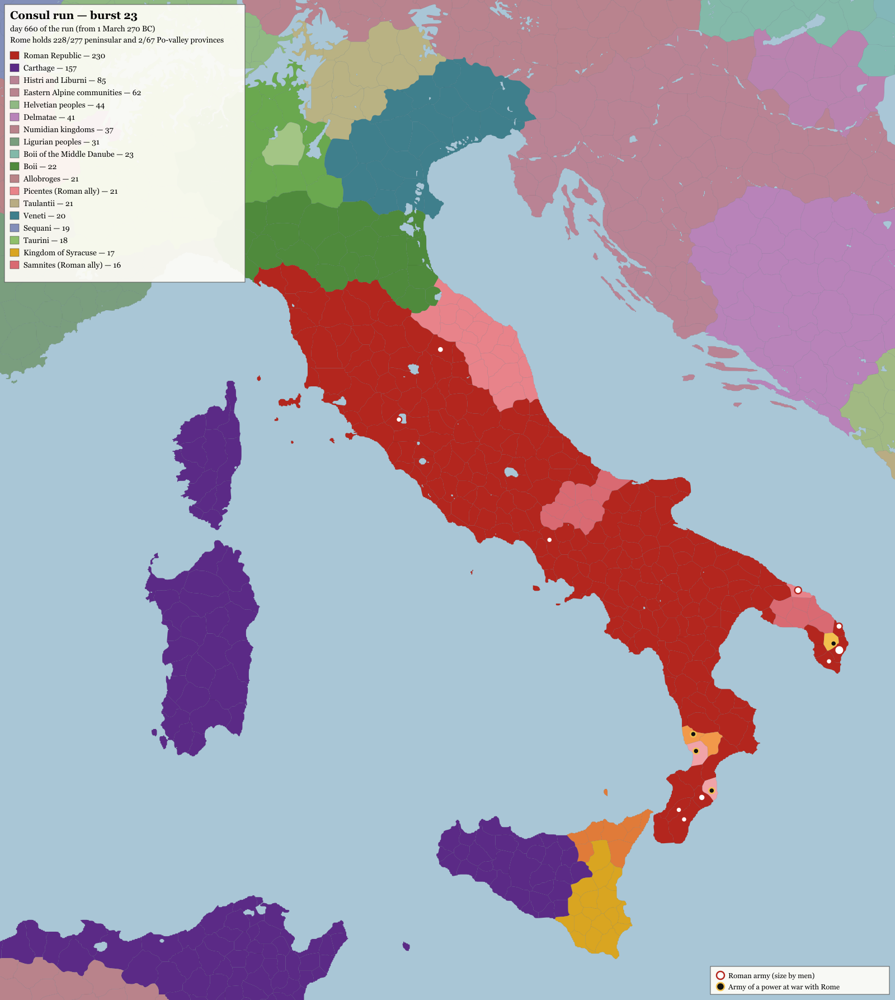

# Consul run: a hand-played Rome, and the issues it found

Date: 2026-10-14. Branch `chronicle-order-truth` (working tree with uncommitted changes). Save: `eval-out/consul-run/state.json` (burst 23), log: `eval-out/consul-run/log.md`.

## What was played

`scripts/consul-run.mts` with the hand adapter: I played Gaius Genucius Clepsina, consul of 270 BC, and also answered every model prompt myself: the orchestrator (the world), reconcile, repair, letters and mechanics. The previous session played bursts 1 to 5. This session played bursts 6 to 23, from 14 June 270 BC to 20 December 269 BC: 23 bursts and about 22 months of game time in all.

The goal was "own all of Italy, Rome an empire, Carthage defeated". **None of the three was reached.** Where the run stopped:

- **Italy.** Rome controls **228 of the 277** provinces of the peninsula and **2 of the 67** in the Po valley. Six allies of the foedus accepted union and became Roman: the Etruscans, Umbrians, Marsi and Paeligni, Lucanians, Bruttians and Apulians (burst 9). Still outside Rome: the Picentes (21) and Samnites (16), who refused union twice; the Ligurians (4); the Boii (2); a reborn Lucanian state (2, see M10); the Campanian Legion (2); the Mamertines (1); the Messapians (1). In the Po valley, the Boii, Taurini, Insubres, Veneti and Ligurians are untouched.
- **Wars.** Rome is still at war with the Campanian Legion (10 months), the Messapians (6 months) and the risen Lucanians. Both small enemies were beaten in battle four or more times, and both are still in the field (see H3 and H4).
- **Carthage.** There has been no war with Carthage. Carthage formed a league with the Campanians, Messapians, Mamertines, Insubres and Boii ("a war on one is a war on all", burst 9), but never entered the war. The Senate voted down the fleet 36 to 43 (burst 10).
- **Empire.** Rome is still an `oligarchic_republic`. The consul's year ended, and the Senate prorogued him as proconsul.
- The treasury stands at 13.5M drachmae (3.5M at the start of this session). Money was never what held the run back.

A caveat on play: to keep the run moving, NPC cognition rounds were answered with `{"actors":[]}`, and census mechanics with `null`. Other powers' people therefore acted only by engine rule. Any outcome a model would have decided reflects my own answers.

*White rings: Roman armies, sized by men. Black dots: armies at war with Rome. Pink Salento provinces were taken by the Picene and Samnite contingents for their own peoples (M5). The renderer is `eval-out/consul-run/render-map.mjs`.*

Severity: **High** corrupts state, sends armies to the wrong place or makes a goal unreachable. **Medium** is a rule that misbehaves or contradicts itself. **Low** is cosmetic, tooling or a design question.

## High

**H1. An order's words override the army's real destination: a substring match.** `namedDestination` (`packages/sim/src/mission-intent.ts:65`) tests `normalized.includes(name)` with no word boundary. `preserveDestination` (`:98`) then replaces the `locationId` of the army's `force_modify` with whatever it found.
- Burst 13: "Hunt down Decius Vibellius" sent the Apulian and Bruttian contingents from Bruttium to **Cius in Western Bithynia** (`thr-gxx49`), 188 days away, because "Deci**us**" contains "cius".
- Burst 14: "...they stay in Bruttium" sent the same contingents, and the detachment of Legio I, to **Tium**, because "Brut**tium**" contains "tium".
- Reproduced with `npx tsx eval-out/consul-run/check-order.mts "<order>"`. "Hunt down Decius Vibellius" resolves to Western Bithynia; "They stay in Bruttium" to Domanitis on the Parthenios; "The Apulian and Bruttian contingents stop where they are" to Uplands of the Maidoi; "...for Rome" to Latium.
- `placeNamed` (`place-named.ts:12`) already uses `\b...\b`. `namedDestination` should do the same, and it should not overwrite a `locationId` the answer named explicitly.

**H2. The engine writes a march that cannot be applied: `name: null`.** `approachFirst` (`packages/sim/src/burst.ts:656`) builds `force_modify` with `name: null, positionId: null, newPosition: null, ...`. `force_modify.name` is a string. The batch is refused with "material.forces.0.name: expected string, received null", and the model gets a repair prompt for an act it never wrote (the burst 6 repair prompt). The `null` fields should be left out.

**H3. A force outnumbered 3:1 can never be caught.** In `engagements.ts:322`, the withdrawal check runs before any manoeuvre (`:345`), so `storm_camp`, `night_attack` and the rest never apply against a weaker force. `retreatRoute` (`packages/shared/src/warfare/retreat.ts:43-80`) always takes a first step, even into hostile ground under an enemy army: a negative score is only refused once already marching. Retreat costs 10% fatigue and no men. In this run:
- The Campanian legion (2,700 men, later 850) "fell back, outnumbered three to one" in bursts 6, 8, 9, 10, 15 and 23, and usually marched straight back into the province it had left.
- The Messapian levy did the same in bursts 17 and 19.
- When the ratio is below 3:1, the weaker side keeps to its camp and then "left its camp by night" (bursts 16, 18, 20), even after `storm_camp` was ordered.
- Battles happened only when armies were split into detachments small enough to fall under 3:1. The Campanians were beaten in bursts 3, 11, 12 and 17, and the Messapians in 12, 18 and 20. Both are still in the field.

**H4. A beaten power never ends, so a war cannot be finished.** Taken together:
- `deditio` (`submission.ts:176`) requires the beaten power to have **no land, no armed force and its capital taken**. With H3, "no armed force" is unreachable.
- Peace offers with a `submission` clause, at a war score of 100/100 ("may dictate the peace") with the enemy at -51 ("must take the terms they are given"), were "refused by silence" every time (bursts 7, 13, 19).
- In the same bursts the beaten side wrote asking for peace (bursts 7, 13, 18, 22). In burst 22 the Campanians refused peace talks by silence and asked for peace in the same month.
- The peace table, where rule-based terms (including submission for a power totally defeated and holding three provinces or fewer, `peace-table.ts:102`) would be signed, is reachable only from the web UI (`apps/web/lib/peace-table-service.ts`). The hand-played and CLI paths cannot put terms.

**H5. The prompt's place for the enemy is misleading: "here, in the same province".** `cognition.ts:596-646` measures the distance from *any* of the actor's forces, or himself. When the consul's 18-man transport flotilla sat at Rhegium coast, the Campanian legion was "about 2,500 men at Rhegium coast, here, in the same province" while the consul and his army were in the Uplands of the Sikeloi (bursts 6, 7, 9, 19). With that line next to a fact like "fell back into Uplands of the Sikeloi" (written before the legion marched back), an order was aimed at the province the enemy had already left, and the engage was refused (burst 7 reconcile). The line should say which of the actor's forces the enemy is near.

**H6. An order split into chunks repeats the world's seeds in every chunk.** `orchestrateFirst` (`orchestrate.ts:466`) sends each line of a long order as its own call with the full slice, including `THE WORLD STIRS`, `COUNTRIES WITH NOBODY IN THEM` and `DUE NOW`. Answering each chunk faithfully creates the seeded thread, the rulers and the forces once per chunk. `mergeOrchestrations` (`:404`) merges them all. Seeds should go in only one chunk (burst 7).

## Medium

**M1. A seed asks for two acts that make two threads.** A thread's turn asks for `storyline_advance` (`narrator.ts:726`) *and* `storyline_open` with its seedKey (`slice.ts:1655`). Doing both made a duplicate: "Decius Vibellius and Gaius Genucius Clepsina" became `storyline-consul-0-183` plus `storyline-consul-5-3` (burst 6). The prompt then asked again on every later seed.

**M2. The thread cap refuses what the prompt demands.** `apply-deltas.ts:4809`: "The world is already following 12 threads of its own; close one before opening another." The seeded `storyline_open` that the same prompt requires is refused (bursts 7 and 18). The 12 threads were mostly "The health of X" for people across the known world.

**M3. A character dropped by the schema becomes a placeholder named after its handle.** `character_create` with `faith: null` is invalid (`faith` is `Name`, not nullable). It is dropped with only "dropped to keep the answer: worldDeltas.3" in the log. The forces that named `local:<handle>` were still created, under invented people named from the handle: "Marsic Meddix", "Umbrian Marones", "Atropatene Ruler". They then sat in cognition rounds under those names (bursts 6, 8, 9 and on). The model is never told why an act was dropped.

**M4. "Countries with nobody in them" lists countries that have rulers.** Media Atropatene (Bagoas, `atropatene-ruler-1n9ev6`) and Cappadocia (Oltaces) were listed, with the instruction to give each "a ruler of its own culture and the forces it would plainly field" (`slice.ts:1637`, principle 5). The test is about forces, but the words ask for a ruler, so a second ruler gets created.

**M5. Allied contingents take enemy ground for their own people.** The foedus levies Rome called against the Messapians took Brundisium and three Messapian provinces for the **Picentes** and **Samnites**, not for Rome (bursts 10 to 23; pink in Salento on the map). The allies then refused union and kept the ground. Ground won in a leader's war by a "no war or peace of their own" ally should be the leader's.

**M6. Union counts an ally's years from the start of the game.** `unionScore` (`submission.ts:77-80`) computes `years` from `foedus.sinceStep` (0 at scenario start), so allies of 290 BC and 304 BC "have followed for 0 years" or "1 years" (bursts 9 and 23). The foedus's historical date is in its own terms ("Allied since 299"). The habit bonus (up to +15) never applies, and the Picentes and Samnites refused with full citizenship offered.

**M7. Agreements of an ended power stay active.** After six allies were absorbed (burst 9), `foedus-etruscan-cities`, `foedus-umbrians`, `foedus-lucanians`, `foedus-bruttians` and the others are still `status: "active"` (seen in the save at burst 15). The prompt's "Rome leads by foedus" line still lists them.

**M8. The order verifier forces a second motion when one already exists.** "Ask the Senate to prorogue my command" was answered with support for the engine's own existing prorogation question (`prorogation:gaius-genucius:365`). The verifier rejected that ("not the kind of act it asks for") and demanded a new `political_procedure_open`. Both went to the Senate in the same burst: the engine's passed 48 to 21, mine failed 35 to 53. The log reports the order as "refused" while the command was in fact prorogued (burst 14). Principle 1 says "Reuse an existing question on the same work".

**M9. A legion's own detachment is "raised without leave" and "beyond his authority".** `force_create` with `fromForceRef` (splitting the field army) was charged as raising men: "raised Cohorts of Legio I without leave to raise anybody; gave orders to a force; took a force into a fight". The prorogation names the forces of its day, so detachments made later are outside the command (bursts 17, 18, 20).

**M10. An absorbed people rises three months later.** The Lucanians accepted union in burst 9, and in burst 23 "Bruttium beneath Mons Skylakion Oros rose against Roman Republic under Numerius Aufidius, and Lucanians stood again". A people that voted for union rose under the man who had led its contingent in Rome's war. That may be intended, but it came with no warning (no grievance or unrest fact in between).

**M11. A march plus an attack in one answer fails when the provinces do not border.** `force_modify` to a non-bordering province becomes a march project. The `force_engage` in the same answer is then refused at once ("cannot meet in battle until one of them has marched") instead of being held for arrival (bursts 14, 15, 16). `approachFirst` skips forces already marching (`marching.has(force.id)`), and `holdForArrival` only holds acts in parts with `afterParts`.

**M12. A deferred attack never fires on arrival.** Burst 11 gave the field army a march and a `deferredActs: [force_engage]`. It arrived, and the next facts read "Messapian levy and Roman field army... stand facing each other. Neither has been ordered to attack."

**M13. An order's outcome contradicts its battle.** "Legio I at Rhegium attacks the Campanian legion wherever it stands, alone" is recorded as **failed**, while the same burst's top fact is Legio I beating the Campanian legion (burst 11). The same order drew "The order's reading sent force-consul-9-11 to it-5sjyb": the force's *name* "Legio I at Rhegium" was read as a destination.

**M14. Ground flips back the day the army leaves.** Rome took the Uplands of the Sikeloi and Bruttium beneath Mons Skylakion Oros while its army stood there. "Their power lost ... to Campanian Legion 0 days ago" when it left (burst 6), with no Campanian army present. Rome also kept the Bruttian (allied) districts it took back from the Campanians as "our lands", instead of returning them to the Bruttians (burst 5 prompt).

**M15. The war score swings.** Rome against the Campanians read 100/100 (burst 6), 51 (burst 6, a few days later), 100 (burst 8), 59 (burst 9), 46 (burst 10), 100 (burst 13). Nothing comparable happened in between: the factors "holds N provinces", "they hold no ground" and "holds cities of theirs" flip as armies step in and out of provinces.

**M16. The same force is in two places in one month.** In burst 15 the Picentes contingent "has arrived in Rhegium coast" and "is starving in Coast of the Sallentini", 300 km apart, in the same burst. In burst 15 the detachment of Legio I was shown at its starting province while its (wrong, H1) march had already carried it to the Samnite uplands.

**M17. Carthage's league is not honoured.** Carthage, the Campanians, Mamertines, Insubres, Boii and Messapians "leagued together against Roman Republic: a war on one is a war on all" (burst 9). Rome was at war with two members for 14 more months, and Carthage never came in. It may be because Rome is the attacker, but no fact or prompt says so.

**M18. The hulls are too small for what they do.** "Allied Greek hulls", 18 to 20 men, blockaded Rhegium's harbour for 62 days (bursts 1 to 4). The Apulian, Bruttian and Etruscan "hulls" sent by the foedus are 5 to 15 men each. Either the unit means "ships", which the display does not say, or the blockade does not weigh its strength.

## Low

**L1. Placeholder ids leak into names.** "Arkamani of the kush xapit5" and "Zelalsan of the mauretanian-peoples w9bv9z" (bursts 15, 20).

**L2. The life-stage wording is wrong.** "Gaius Genucius Clepsina has fallen ill in the later years of life" at 46 (burst 20).

**L3. "Dropped to keep the answer" does not say why.** The run log gives indices only (`worldDeltas.3, worldDeltas.5`). The schema error that dropped them should be printed, and should go back to the model.

**L4. Letters to the player's power are refused by silence, unseen.** "Roman Republic refused Massalia by silence on 'Massalia asks Roman Republic for help'" (burst 22). The protection requests from Massalia and Syracuse never reached the player as a decision.

**L5. Rome counts in drachmae.** Budgets show "800,000 Drachmae" for a Roman levy. The scenario has a single money unit, but the label reads oddly for Rome.

**L6. A commander parted from his army still commands it.** Decius Vibellius was cut off in burst 12. He is at `it-k26pi` while his legion is at `it-a55cw` (save at burst 23), and he still commands it.

## Tooling (the hand-played path)

**T1. A BOM blocks an answer silently.** The hand adapter treats an answer file with a UTF-8 BOM as missing and waits again with no error. PowerShell 5.1's `Set-Content -Encoding utf8` writes a BOM.

**T2. A split order costs a full replay per chunk.** Each chunk of a split order is a separate prompt (H6), and the hand adapter stops at the first unanswered one. A 3-sentence order means three replays of the burst.

**T3. No peace table, no union lever.** `consul-run.mts` cannot open or work a peace table (H4), and it does not show pending letters to answer. Those are only in the orchestrate prompt.

## Files

- Report map: `docs/reports/consul-run-map.png`, drawn by `eval-out/consul-run/render-map.mjs` (`node eval-out/consul-run/render-map.mjs <out.png> [west south east north] [width]`).
- Destination check for H1: `eval-out/consul-run/check-order.mts`.
- Log of all 23 bursts: `eval-out/consul-run/log.md`. Every prompt and answer: `eval-out/consul-run/*.prompt.txt` / `*.json`.
